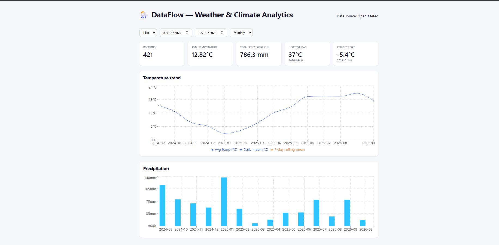

# DataFlow — Weather & Climate Analytics Pipeline (Lille)

An end-to-end data engineering project: a Python pipeline pulls real historical
daily weather data for Lille (and, optionally, comparison cities) from the
[Open-Meteo](https://open-meteo.com/) archive API, validates and cleans it,
loads it into PostgreSQL with idempotent upserts, and serves analytics
through a FastAPI backend consumed by a React dashboard.

## Problem

Recruiters for Data Engineering / Data / Big Data internships want to see a
small, real, explainable pipeline — not a toy script. DataFlow demonstrates
ingestion, validation, cleaning, transformation, relational modeling,
idempotent loading, an analytics API, and a dashboard, end to end, on a
genuinely reproducible public dataset.

## Dataset

**Open-Meteo Historical Weather API** (`archive-api.open-meteo.com`) — free,
no API key for the public historical endpoint (check current usage terms),
with extensive historical coverage. The MVP pulls one year of daily weather for **Lille,
France** (lat 50.6292, lon 3.0573): max/min/mean temperature, precipitation
sum, max wind speed, mean humidity, and WMO weather code.
## Dashboard


## Architecture

```
Open-Meteo Archive API
        │
        ▼
 [Ingestion]   pipeline/ingest.py    — HTTP + retry/backoff, caches raw
        │                              JSON responses in data/raw/
        ▼
 [Validation]  pipeline/validate.py  — schema, type, and range checks
        │
        ▼
 [Cleaning]    pipeline/clean.py     — dedup, outlier flagging, imputation
        │
        ▼
 [Transform]   pipeline/transform.py — tabular reshape + derived fields
        │
        ▼
 [PostgreSQL]  sql/schema_postgres.sql — normalized schema, idempotent upserts
        │
        ▼
 [FastAPI]     backend/              — /api/metrics, /api/trends, /api/records
        │
        ▼
 [React]       frontend/             — KPI cards, charts, filters, data-quality panel
```

Each pipeline stage is a separate module with one responsibility, so any
stage can be tested, re-run, or replaced independently.

## Pipeline

`pipeline/run_pipeline.py` orchestrates the five stages for every configured
city (`pipeline/config.py`) and records a row in `pipeline_runs` for every
attempt, success or failure, so the dashboard's data-quality panel reflects
real run history rather than a static blurb.

```bash
# Normal run: calls the real Open-Meteo API
python -m pipeline.run_pipeline --start 2024-09-01 --end 2025-08-31

# Offline run: replays an already-saved raw snapshot from data/raw/
# instead of calling the network (used by the automated tests, and useful
# in CI environments without outbound internet access)
python -m pipeline.run_pipeline --city Lille --start 2026-09-26 --end 2026-10-10 --offline
```

## Data Quality

Real checks, not decorative ones:

| Check | Where | Behaviour |
|---|---|---|
| Missing required fields | `validate.py` | row flagged invalid, not silently dropped |
| Invalid / unparseable date | `validate.py` | row flagged invalid |
| Non-numeric value in a numeric field | `validate.py` | row flagged invalid |
| `temp_min > temp_max` | `validate.py` | row flagged invalid |
| Negative precipitation / wind speed | `validate.py` | row flagged invalid |
| Duplicate `(city, date)` | `clean.py` | duplicate removed, counted |
| Extreme value (temperature/precipitation outside configured fixed ranges) | `clean.py` | **flagged, not dropped** — `is_outlier` column, kept for the anomaly view |
| Isolated single-day gap in `temperature_2m_mean` | `clean.py` | filled only if both neighboring calendar days are present and non-null; flagged `is_imputed` |
| Any other missing value (e.g. `precipitation_sum`) | *(no rule)* | left as a genuine `NULL` — **never fabricated** |

Every pipeline run writes `records_processed`, `valid_records`,
`duplicates_removed`, `invalid_records`, `outliers_flagged`, and `status` to
the `pipeline_runs` table — these are the real numbers from the actual run,
not illustrative placeholders (see "Actual test results" below).

## Database Schema

PostgreSQL (canonical DDL in `sql/schema_postgres.sql`; an equivalent SQLite
schema is embedded in `pipeline/load.py` for local/dev/test use with zero
external services):

- **`locations`** — one row per (city, country). `UNIQUE(city_name, country)`.
- **`daily_weather`** — one row per (location, date). Foreign key to
  `locations`. `UNIQUE(location_id, observation_date)` is what makes the
  load idempotent: re-running the pipeline for an already-loaded date range
  updates existing rows (`ON CONFLICT ... DO UPDATE`) instead of duplicating
  them.
- **`pipeline_runs`** — one row per pipeline execution, feeding the
  dashboard's data-quality panel.

After each upsert, the loader refreshes seven-calendar-day rolling averages
from the full stored history for that city. This prevents overlapping or
partial reruns from leaving inconsistent rolling statistics.

Indexes on `observation_date` and `(location_id, observation_date)` support
the date-range queries the API relies on.

## Analytics

See `sql/analytics_queries.sql` for illustrative PostgreSQL analytics queries
(overall KPIs, monthly trends, daily trends, seasonal comparison, and data
quality). The FastAPI backend uses parameterized selects with pandas
aggregations (`backend/routers/analytics.py`) for consistent behavior across
SQLite and PostgreSQL. Unknown precipitation remains `null`, not zero.
Monthly series include null months when the database has a data gap.

## Dashboard

React + Recharts. City selector, date range, daily/monthly granularity
toggle, KPI cards (records, avg temp, total precipitation, hottest/coldest
day), temperature trend (daily mean + 7-day rolling mean), precipitation
bar chart, and a data-quality panel showing recent pipeline runs. Initial
date filters use the available dates of the selected city, not today's date.

## Tech Stack

Python 3.12 · pandas · requests · PostgreSQL 16 · FastAPI · React 18 +
Vite · Recharts · Docker Compose.

## Installation

Requirements: Python 3.12, Node.js 20.19+ for Vite 8, npm, and optionally
Docker Desktop with Compose. Use a Python virtual environment if preferred.

```bash
git clone YOUR_REPOSITORY_URL
cd dataflow
pip install -r requirements.txt
```

For the dashboard:

```bash
cd frontend
npm ci
```

Copy `.env.example` to `.env` and choose a private PostgreSQL password when
using Docker Compose. The `.env` file is read by Compose, **not** automatically
by the local Python process; set `DATABASE_URL` in your shell for local runs.
The dashboard uses same-origin `/api` URLs: Vite proxies to port 8000 during
development, and Docker's nginx proxies to the backend service.

## Running the pipeline

**With Docker Compose (PostgreSQL):**
```bash
docker compose up -d db
docker compose run --rm pipeline --start 2024-09-01 --end 2025-08-31
```

**Locally without Docker (SQLite, zero external services):**
```bash
export DATABASE_URL=sqlite:///./data/dataflow.db   # Bash / Git Bash
python -m pipeline.run_pipeline --start 2024-09-01 --end 2025-08-31
```

PowerShell equivalent:

```powershell
$env:DATABASE_URL = "sqlite:///./data/dataflow.db"
python -m pipeline.run_pipeline --start 2024-09-01 --end 2025-08-31
```

## Running the dashboard

```bash
docker compose up -d --build  # db + backend + frontend; pipeline is on demand
# or, locally:
uvicorn backend.main:app --reload --port 8000     # in one terminal
cd frontend && npm run dev                          # in another
```

Dashboard: http://localhost:5173 (or http://localhost:5173 via Docker) ·
API: http://localhost:8000 · API docs: http://localhost:8000/docs

## Testing

```bash
python -m unittest discover -s tests -v
```

Covers: validation rules (including malformed API payloads), cleaning
(dedup / outlier flagging / isolated imputation), time-based rolling averages,
SQLite idempotent upserts and cross-batch refresh, full offline integration,
and API endpoints including null precipitation and invalid query parameters.
API tests are automatically skipped if FastAPI is not installed.
GitHub Actions (`.github/workflows/ci.yml`) runs the Python tests and builds
the React dashboard on every push and pull request.

## Included data and limitations
 
The ZIP includes captured public weather-data JSON files and a small
15-day replay fixture so offline tests can run without an external API.
The fixture came from a third-party Open-Meteo-backed proxy that did not
expose precipitation or humidity; those fields remain genuine `null`s.
For dashboard demonstrations with complete precipitation, run a live
Open-Meteo pull (or use a matching snapshot captured directly from the API). 
 
The included historical date ranges have a significant gap between
August 2025 and August 2026. Monthly charts explicitly display this gap.
Raw JSON files are reproducibility **caches**, not immutable audit logs:
fetching the same city/date range overwrites the matching cache file.
Large-scale processing, authentication, scheduling, and production operations
are outside this educational project's current scope. PostgreSQL and Docker
need a machine with their respective services available for end-to-end checks.

## Sharing and security

- Share only source code, captured public fixtures, docs, and `.env.example`.
- Do **not** share `.env`, `frontend/node_modules/`, `.git/`, local SQLite
  databases, or generated build files.
- PostgreSQL and the direct API port are bound to `127.0.0.1` by Compose;
  the frontend nginx proxy exposes read-only weather analytics endpoints.
- Do not expose this educational stack to the public internet without adding
  appropriate authentication, rate limiting, HTTPS, and deployment hardening.

## Future Improvements

- Scheduled/incremental ingestion (e.g. a daily cron job that only pulls
  new days) with structured logging — deliberately deferred past the MVP
  per the project's own scope decision to avoid unexplainable complexity.
- Basic auth / rate limiting on the API if it were ever exposed publicly.
- Automated integration checks against a real PostgreSQL instance and
  a smoke test of the full Docker Compose stack on each pull request.

## Why this generalizes to larger-scale systems

At Lille-only, one-year scale, this project intentionally does not need
Spark, Kafka, or Airflow — a single-machine Python pipeline and PostgreSQL
comfortably handle a few thousand rows. What *would* change at real
Big-Data scale: ingestion would move from a single retry loop to a
distributed/queued fetcher (many cities, many sources); validation/cleaning
would run as a distributed batch job (Spark) instead of in-process pandas;
loading would batch/partition writes instead of row-by-row upserts; and
orchestration would move from a single CLI script to a scheduler like
Airflow coordinating multiple pipeline runs with retries, backfills, and
monitoring. The current architecture's separation into distinct,
single-responsibility stages is exactly what makes that swap possible one
stage at a time, without a rewrite.

---

## Author

**Khalil Lamrabet**

Engineering Student — Big Data & Artificial Intelligence

- GitHub: [@Xerow42](https://github.com/Xerow42)
- LinkedIn: [khalillam12](https://www.linkedin.com/in/khalillam12/)
- Email: [klamrabeta19@gmail.com](mailto:klamrabeta19@gmail.com)
